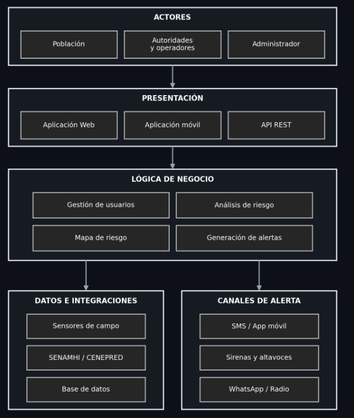

# Arquitectura inicial

## Sistema de Alertas Tempranas ante Desastres Naturales y Lluvias en la Región de Ayacucho

La solución propone una aplicación web organizada por capas y módulos para gestionar alertas, zonas de riesgo, información de monitoreo y notificaciones.

### Diagrama de arquitectura

### Capa de presentación
- Aplicación web
- Panel administrativo
- Mapa de alertas
- Consulta de alertas y recomendaciones

### Capa de aplicación
- Gestión de alertas
- Gestión de usuarios
- Gestión de zonas de riesgo
- Gestión de notificaciones
- Consulta meteorológica
- Historial de eventos

### Capa de dominio
- Alerta
- Zona de riesgo
- Evento natural
- Usuario
- Notificación
- Registro meteorológico

### Capa de infraestructura
- Base de datos
- Servicio de notificaciones
- Servicio de mapas/geolocalización
- Fuente de datos meteorológicos

### Flujo básico
1. Se registra o recibe información de un evento.
2. Se valida la información.
3. Se genera o actualiza una alerta.
4. Se determina la zona y nivel de riesgo.
5. Se publica la alerta.
6. Se envían notificaciones.
7. Las autoridades realizan seguimiento.
