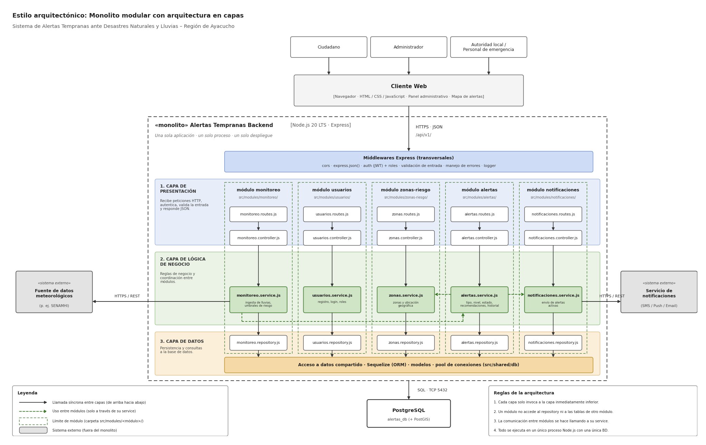

# Estilo arquitectónico

## Sistema de Alertas Tempranas ante Desastres Naturales y Lluvias en la Región de Ayacucho

### Estilo seleccionado: Monolito modular con arquitectura en capas

El sistema se construye como **una sola aplicación, un solo proceso y un solo despliegue** (monolito), internamente organizada en **módulos de negocio independientes** y estructurada en **tres capas** (presentación, lógica de negocio y datos). Los módulos se comunican entre sí únicamente a través de sus servicios, y toda la persistencia se realiza sobre una única base de datos.

### Tecnologías de referencia
| Elemento | Tecnología |
|---|---|
| Backend | Node.js 20 LTS + Express |
| Cliente web | Navegador (HTML / CSS / JavaScript) |
| Comunicación cliente-servidor | HTTPS + JSON (`/api/v1/`) |
| Acceso a datos | Sequelize (ORM) + pool de conexiones |
| Base de datos | PostgreSQL (con PostGIS para datos geográficos) |

### Diagrama de arquitectura



### Capas

| Capa | Responsabilidad | Componentes |
|---|---|---|
| **1. Presentación** | Recibe peticiones HTTP, autentica, valida la entrada y responde JSON. | `*.routes.js`, `*.controller.js` |
| **2. Lógica de negocio** | Reglas de negocio y coordinación entre módulos. | `*.service.js` |
| **3. Datos** | Persistencia y consultas a la base de datos. | `*.repository.js`, Sequelize, modelos |

### Middlewares transversales (Express)
- `cors`
- `express.json()`
- Autenticación (JWT) y control de roles (Administrador, Autoridad, Personal de emergencia, Ciudadano)
- Validación de entrada
- Manejo de errores
- Logger

### Módulos del monolito (`src/modules/<módulo>/`)

| Módulo | Responsabilidad | Requisitos que cubre |
|---|---|---|
| **usuarios** | Registro, login y administración de roles. | RF01 |
| **alertas** | Registro, edición, clasificación por tipo, nivel de riesgo, estado, recomendaciones e historial de alertas. | RF02, RF03, RF04, RF07, RF08, RF09 |
| **zonas-riesgo** | Registro y gestión de zonas afectadas o en riesgo (ubicación geográfica). | RF05 |
| **notificaciones** | Envío de notificaciones de alertas activas a la población. | RF06 |
| **monitoreo** | Consulta e ingesta de datos de lluvias y condiciones de riesgo. | RF10 |

### Estructura de carpetas propuesta

```
src/
├── modules/
│   ├── usuarios/        (routes, controller, service, repository)
│   ├── alertas/         (routes, controller, service, repository)
│   ├── zonas-riesgo/    (routes, controller, service, repository)
│   ├── notificaciones/  (routes, controller, service, repository)
│   └── monitoreo/       (routes, controller, service, repository)
├── middlewares/
└── shared/
    └── db/              (Sequelize, modelos, pool de conexiones)
```

### Sistemas externos (fuera del monolito)
- **Servicio de notificaciones** (SMS / push / email): comunicación vía HTTPS / REST desde `notificaciones.service`.
- **Fuente de datos meteorológicos** (p. ej. SENAMHI): consumo vía HTTPS / REST desde `monitoreo.service`.
- **Servicio de mapas / geolocalización**: usado por el cliente web para el mapa de alertas.

### Reglas de la arquitectura
1. Cada capa solo invoca a la capa inmediatamente inferior.
2. Un módulo no accede al repository ni a las tablas de otro módulo.
3. La comunicación entre módulos se hace llamando a su service.
4. Todo se ejecuta en un único proceso Node.js con una única base de datos.

### Leyenda
- Flecha sólida: llamada síncrona entre capas (de arriba hacia abajo).
- Flecha punteada: uso entre módulos (solo a través de su service).
- Límite de módulo: carpeta `src/modules/<módulo>/`.
- Sistema externo: fuera del monolito.

### Justificación del estilo frente a los drivers

| Driver | Cómo lo satisface el estilo |
|---|---|
| DA01 Disponibilidad | Un solo despliegue simple de operar; se puede replicar la instancia detrás de un balanceador. |
| DA02 Rendimiento | Llamadas en proceso entre módulos (sin latencia de red); consultas geográficas indexadas en PostgreSQL/PostGIS. |
| DA03 Seguridad | Punto único de entrada con middlewares de autenticación JWT, roles y validación. |
| DA04 Integración | Integraciones externas aisladas en los services de `monitoreo` y `notificaciones`. |
| DA05 Escalabilidad | Escalado horizontal de instancias; los módulos pueden extraerse a servicios si fuera necesario. |
| DA06 Usabilidad | API JSON simple que alimenta un cliente web claro y orientado a la población. |
| DA07 Confiabilidad | Una sola base de datos con transacciones y consistencia; validación antes de publicar. |
| DA08 Mantenibilidad | Límites claros por módulo y capa; reglas que evitan acoplamiento. |
