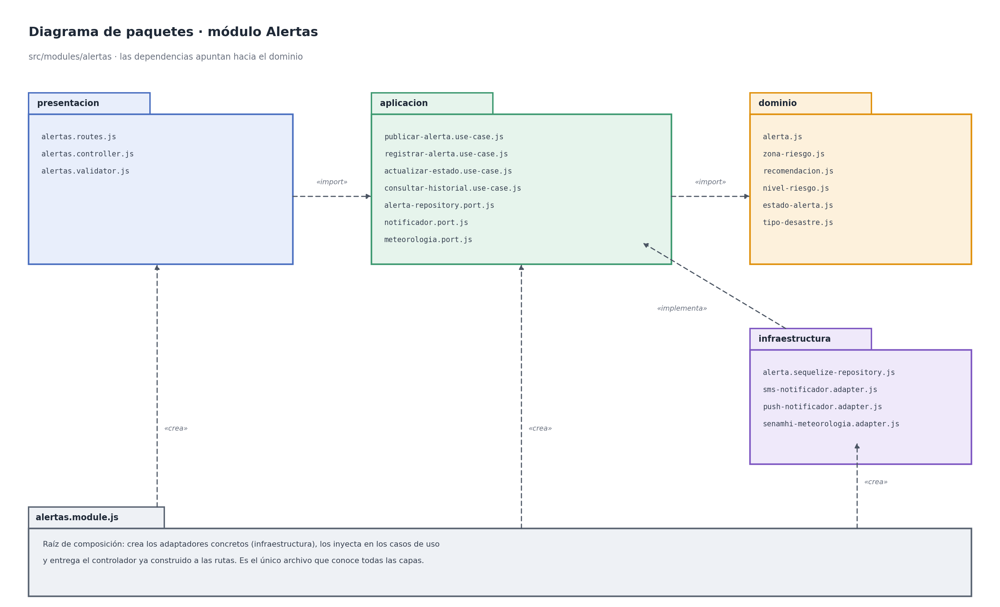

# 1. Capas del módulo y regla de dependencia

## Sistema de Alertas Tempranas ante Desastres Naturales y Lluvias en la Región de Ayacucho

Cada módulo del monolito (`usuarios`, `alertas`, `zonas-riesgo`, `notificaciones`, `monitoreo`) se organiza con las cuatro capas de Clean Architecture definidas en el [enfoque arquitectónico](../arquitectura/enfoque-arquitectonico.md). Como ejemplo se detalla el módulo **Alertas**, el más importante del sistema; los demás módulos siguen la misma estructura.



**Regla de dependencia:** el código solo puede importar hacia el centro (dominio). El dominio no conoce Express, PostgreSQL, Sequelize ni los proveedores de SMS/push ni SENAMHI.

| Capa | Contiene | Responsabilidad | Puede depender de | No puede depender de |
|---|---|---|---|---|
| **Dominio** | Entidades (Alerta, ZonaRiesgo, Recomendacion), objetos de valor, enumeraciones (NivelRiesgo, EstadoAlerta, TipoDesastre) | Reglas de negocio de las alertas que serán ciertas con cualquier tecnología: validación, niveles de riesgo y estados válidos. | Nada externo | Aplicación, infraestructura, presentación, Express, ORM, SDK |
| **Aplicación** | Casos de uso (PublicarAlerta, RegistrarAlerta, ActualizarEstado, ConsultarHistorial) y puertos (interfaces) | Orquestar el flujo: qué paso va primero y qué hacer si falla un servicio externo. | Dominio | Infraestructura, presentación, Express, ORM |
| **Infraestructura** | Repositorios concretos (Sequelize + PostgreSQL/PostGIS) y adaptadores de servicios externos (notificaciones, SENAMHI) | Implementar los puertos definidos en la capa de aplicación con una tecnología concreta. | Aplicación (puertos), dominio, librerías externas | Presentación |
| **Presentación** | Rutas, controladores y validadores de entrada | Recibir la petición HTTP, autenticar, validar la entrada y responder JSON. | Aplicación | Dominio directamente, infraestructura, ORM |

## Raíz de composición

`alertas.module.js` es el único archivo que conoce todas las capas: crea los adaptadores concretos (`AlertaSequelizeRepository`, `SmsNotificadorAdapter`, `SenamhiMeteorologiaAdapter`), los inyecta en los casos de uso y entrega el controlador ya construido a las rutas. Gracias a esto se puede cambiar el proveedor de SMS o la fuente meteorológica sin tocar el dominio ni los casos de uso.

## Estructura de carpetas del módulo

```
src/modules/alertas/
├── presentacion/
│   ├── alertas.routes.js
│   ├── alertas.controller.js
│   └── alertas.validator.js
├── aplicacion/
│   ├── publicar-alerta.use-case.js
│   ├── registrar-alerta.use-case.js
│   ├── actualizar-estado.use-case.js
│   ├── consultar-historial.use-case.js
│   ├── alerta-repository.port.js
│   ├── notificador.port.js
│   └── meteorologia.port.js
├── dominio/
│   ├── alerta.js
│   ├── zona-riesgo.js
│   ├── recomendacion.js
│   ├── nivel-riesgo.js
│   ├── estado-alerta.js
│   └── tipo-desastre.js
├── infraestructura/
│   ├── alerta.sequelize-repository.js
│   ├── sms-notificador.adapter.js
│   ├── push-notificador.adapter.js
│   └── senamhi-meteorologia.adapter.js
└── alertas.module.js
```
