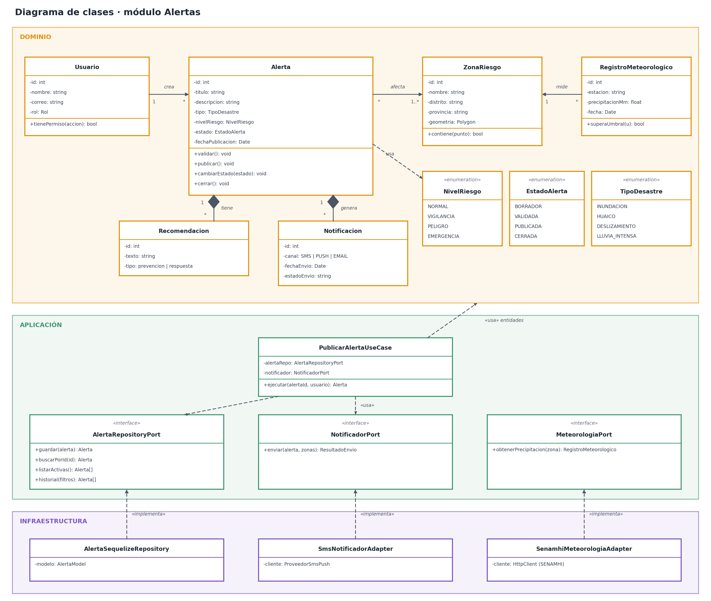
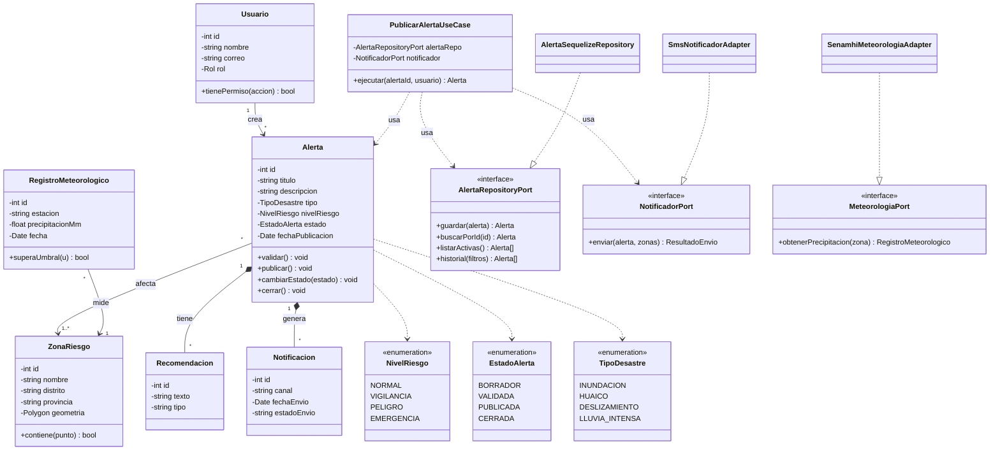

# 2. Diagrama de clases

## Sistema de Alertas Tempranas ante Desastres Naturales y Lluvias en la Región de Ayacucho

Diagrama de clases del módulo **Alertas**, organizado por capas: dominio (entidades y enumeraciones), aplicación (caso de uso y puertos) e infraestructura (adaptadores).

## Descripción de las clases

| Clase | Capa | Descripción | Requisitos |
|---|---|---|---|
| **Usuario** | Dominio | Persona con rol (Administrador, Autoridad local, Personal de emergencia, Ciudadano). | RF01 |
| **Alerta** | Dominio | Entidad principal: tipo de desastre, nivel de riesgo, estado y reglas de validación/publicación. | RF02, RF03, RF04, RF09 |
| **ZonaRiesgo** | Dominio | Zona afectada o en riesgo, con su ubicación geográfica. | RF05 |
| **Recomendacion** | Dominio | Recomendación de prevención o respuesta asociada a una alerta. | RF07 |
| **Notificacion** | Dominio | Aviso enviado por un canal (SMS, push, correo) para una alerta activa. | RF06 |
| **RegistroMeteorologico** | Dominio | Dato de lluvia de una estación, asociado a una zona. | RF10 |
| **NivelRiesgo / EstadoAlerta / TipoDesastre** | Dominio | Enumeraciones del dominio de alertas. | RF03, RF04, RF09 |
| **PublicarAlertaUseCase** | Aplicación | Orquesta la publicación: busca, valida, guarda y notifica. | RF02, RF06 |
| **AlertaRepositoryPort / NotificadorPort / MeteorologiaPort** | Aplicación | Interfaces (puertos) que la infraestructura implementa. | RF06, RF08, RF10 |
| **AlertaSequelizeRepository / SmsNotificadorAdapter / SenamhiMeteorologiaAdapter** | Infraestructura | Implementaciones concretas con Sequelize/PostgreSQL, proveedor de notificaciones y SENAMHI. | RF06, RF08, RF10 |

## Relaciones principales

- Un **Usuario** crea muchas **Alertas**.
- Una **Alerta** afecta a una o más **Zonas de riesgo**.
- Una **Alerta** tiene (composición) muchas **Recomendaciones** y genera muchas **Notificaciones**.
- Un **RegistroMeteorologico** mide una **ZonaRiesgo**.
- El caso de uso depende de **puertos**, no de las implementaciones; los **adaptadores** implementan los puertos.

Código Mermaid (editable, se visualiza en GitHub)

