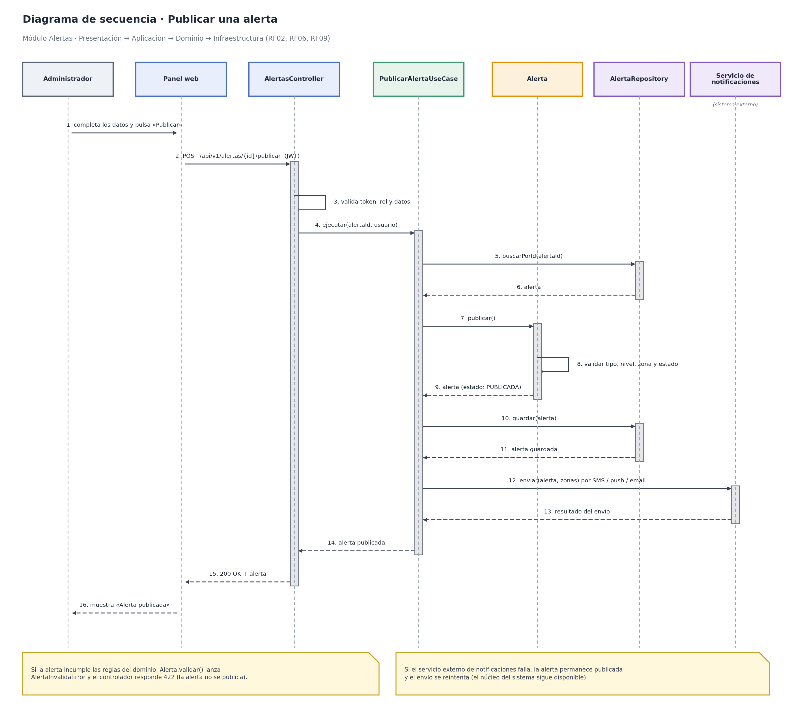
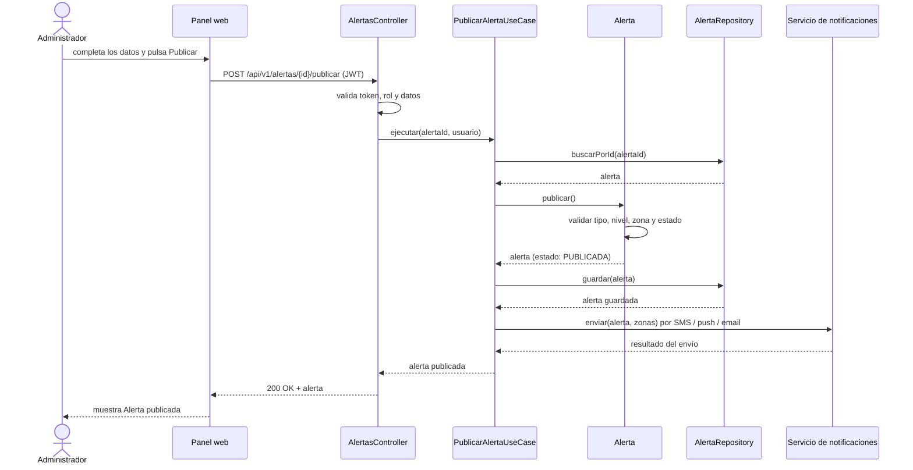

# 3. Diagrama de secuencia

## Sistema de Alertas Tempranas ante Desastres Naturales y Lluvias en la Región de Ayacucho

Secuencia del caso de uso **Publicar una alerta** (RF02, RF06, RF09), que recorre las cuatro capas del módulo Alertas. Corresponde al flujo descrito en el [enfoque arquitectónico](../arquitectura/enfoque-arquitectonico.md).

## Descripción del flujo

1. El administrador completa los datos y pulsa «Publicar» en el panel web.
2. El panel envía `POST /api/v1/alertas/{id}/publicar` con el token JWT.
3. El controlador valida el token, el rol y los datos de entrada.
4. El controlador invoca el caso de uso `PublicarAlertaUseCase`.
5. El caso de uso busca la alerta en el repositorio.
6. La entidad `Alerta` valida sus reglas (tipo, nivel de riesgo, zona y estado) y pasa a *PUBLICADA*.
7. El repositorio guarda la alerta en PostgreSQL.
8. El caso de uso envía las notificaciones (SMS, push, correo) mediante el servicio externo.
9. El controlador responde `200 OK` y el panel muestra la confirmación.

**Flujos alternativos**
- Si la alerta incumple las reglas del dominio, se lanza `AlertaInvalidaError` y el controlador responde `422`; la alerta no se publica.
- Si el servicio externo de notificaciones falla, la alerta permanece publicada y el envío se reintenta (el núcleo del sistema sigue disponible).

Código Mermaid (editable, se visualiza en GitHub)

